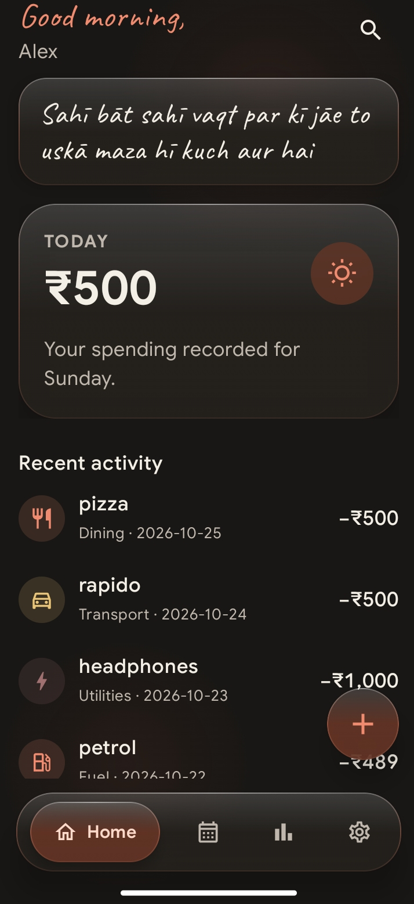
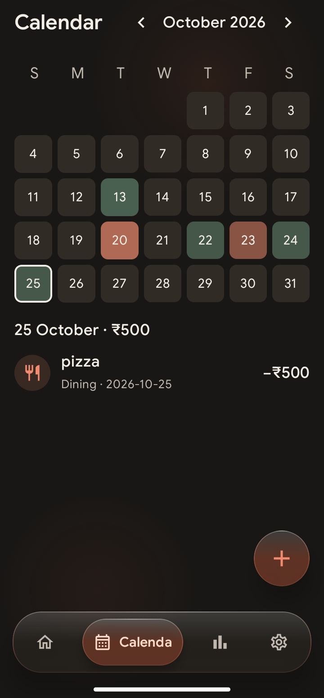
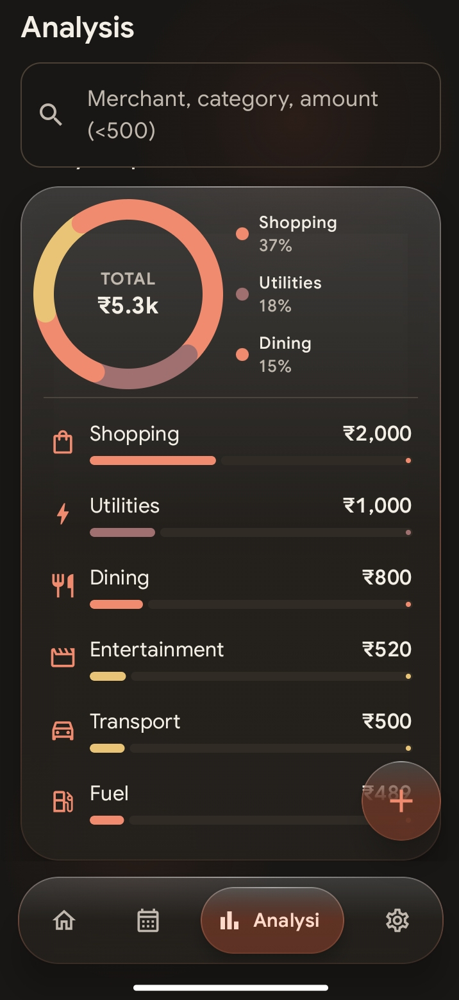
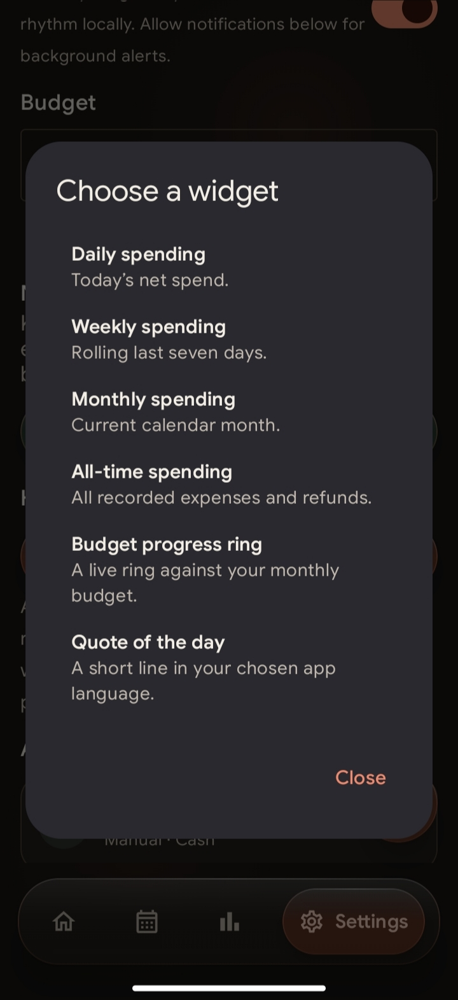
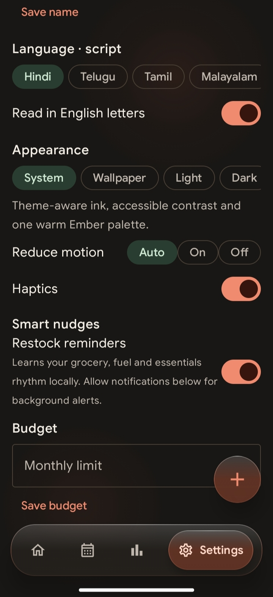

<div align="center">

# Khata

**Your money. Your phone. Nobody else.**

A private, offline money tracker for Android.
No bank linking. No sign-up. No cloud. No judgment (mostly).


[Visit the website](https://vijayarkananduri.github.io/khata/) | [Download the latest APK](https://github.com/vijayarkananduri/khata/releases/latest)

<br>







</div>

---

## The pitch

*Khata* is the old word for the ledger, the book where the shopkeeper wrote down what came in and what went out.

This is that book, on your phone. You write the entries. The app keeps them. Nobody else gets a copy, because there is no "else": no server, no account, no analytics team studying your chai habit.

## Khata is for you if

- You think your bank statement is none of an app's business
- You are happy to type in your own spending
- You would rather see where your money went than be told how to invest it

## Khata is not for you if

- You want expenses to appear automatically from your bank
- You want AI forecasts, scores or "smart insights"

It tracks. That's the whole job. It does the job quietly.

## What it does

**Tracks, privately.** Log expenses, income, transfers and past transactions in a few taps. Everything stays on your device. Import a validated CSV or export your full transaction history whenever you need it.

**Shows your year like a commit graph.** A compact GitHub-style heatmap lets you pick a month and year to see focused spending, categories and top merchants without burying the useful numbers.

**Nudges you before you run out.** Once Khata has seen you buy the same item more than twice, it works out how often you buy it and reminds you when the next purchase is due. A litre of milk that lasts two days gets a reminder on day two. The maths happens on your phone, and you can turn nudges off in Settings.

**Lives on your home screen.** Widgets for daily, weekly, monthly or all-time totals, and for monthly budget progress.

**Has a personality.** Time-aware quotes in your language bring a little warmth to the home screen. Long notes open in full when you tap them.

**Speaks your language.** Hindi, Telugu, Tamil, Malayalam and Kannada, in the original script or in English letters.

**Matches your phone.** Light, Dark, System or wallpaper-derived accents, with warm paper surfaces and readable ink kept consistent.

**Stays current, on your terms.** Check for a new GitHub release or star the project from Settings. Khata contacts GitHub only when you ask it to check; this never uploads transaction data.

## Things Khata will never do

- Ask for your bank login
- Ask you to create an account
- Need internet to work
- Send your data anywhere unless you export it yourself

## Install

1. Open the [latest release](https://github.com/vijayarkananduri/khata/releases/latest)
2. Download the APK and open it on your phone
3. If Android asks, allow installs from your browser or file manager

## Build it yourself

You need JDK 17 and Android SDK 35.

```bash
git clone https://github.com/vijayarkananduri/khata.git
cd khata
./gradlew testDebugUnitTest assembleDebug
```

## Built with

Kotlin, Jetpack Compose and Room.

## Contributing

Found a bug, or have an idea that fits the "private, simple, offline" rule? [Open an issue](https://github.com/vijayarkananduri/khata/issues). Ideas that need a server will be politely declined.

## License

Khata is open source under the [MIT License](LICENSE).
Bundled fonts have their own licenses in `app/src/main/assets/licenses/`.
